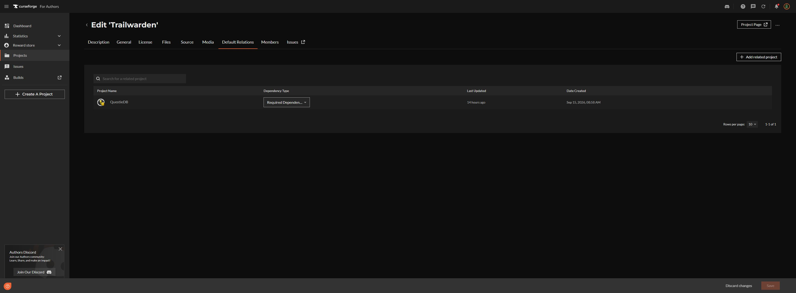

# Trailwarden quality review — 11 November 2026

## Assessment

Distribution is operational for the public beta: CurseForge file **9558950**, `v1.7.4-beta`, is approved for Forever 1.60.1 and appears as the project's main file. Its runtime Lua, TOC and arrow asset are byte-identical to `main` at `a045ceb37fcc37364674b722fd93f7546b314878`. The release job `43043457841` completed successfully.

This review found a gameplay update defect and missing installation metadata. The metadata has been repaired on CurseForge. Code fixes are proposed as **1.7.5**, preserving the published archives and existing TrailwardenDB profiles. The review does not certify exhaustive live gameplay or approve a stable release.

## Findings and disposition

| Priority | Finding and player impact | Disposition |
| --- | --- | --- |
| P2 | Quest failure is absent from the progress fingerprint. An ordinary QUEST_LOG_UPDATE can therefore be throttled as unchanged for up to 60 seconds, retaining a failed escort or objective. Error recovery can also recreate a failed step. | 1.7.5 includes failure in the fingerprint, returns no active steps for failed quests, and rejects them during planner-error recovery. Four regressions cover failure, direct step generation, restart and simultaneous planner failure. |
| P2 | CurseForge declared zero dependencies although the TOC requires QuestieDB. A fresh install through an addon manager could omit the required database. | Saved QuestieDB project **1696795** as Required Dependency in project defaults and on the existing 1.7.4 file. The public file-specific Related Projects page confirms the relation. `.pkgmeta` also declares `questiedb` for subsequent packages. Actual CurseForge-app installation was not exercised. |
| P3 | QuestieDB uses `{-1,-1}` to represent an entity without a mapped position. If map-type metadata is unavailable, this sentinel is treated as corruption and can abort the transactional catalog. | 1.7.5 ignores only this exact sentinel and retains valid alternatives. Three contract regressions cover mixed positions, unmapped-only entities and complete catalog publication. Other invalid coordinates remain rejected. |

The sentinel failure was reproduced with real provider data for quest 1051 / NPC 3981 in an emulated client with missing map metadata. Correct dungeon map types already exclude this position; it is a conditional resilience defect, not evidence that every live login fails. No such sentinels were found in the provider's NPC positions for Trailwarden's known open-world zones during this review.

## Verification

| Check | Result |
| --- | --- |
| Downloaded CurseForge 1.7.4 ZIP | Valid CRC, one correct `Trailwarden/` root, all TOC files and arrow present, no development directories; runtime matches verified source. |
| Published ZIP executed with the frozen main test harness | **455 checks and 40 replay frames passed under Lua 5.1.5.** These existing tests did not cover the newly found defects. |
| Proposed 1.7.5 suites | **462 checks and 40 replay frames passed under both Lua 5.1 and Lua 5.4.** |
| Actual QuestieDB 1.0.14 Forever integration | Native provider code and CBOR data loaded under Lua 5.1. All **5,682 quests** entered the catalog with unavailable map metadata; real accepted-quest sources, explicit focus and XP forecasts passed without planner/forecast errors. |
| Package and versions | TOC, runtime and bundled version agree on 1.7.5; versioned release notes present; installable ZIP validates and is byte-identical across repeated builds. |
| Existing regression coverage | Character isolation and profile repair; quest acceptance/progress/turn-in; local/cave batching and escorts; XP rollover, pause and forecasts; combat gating; owned/user waypoints; stale navigation; collapsed layout and missing-data recovery. |

Provider integration uses the official `QuestieDB-1.0.14-Forever.zip` from the provider's GitHub release, version commit `e19dfdf8528334ea63da0ecc4e291c134c0fc266`, contract 4. Client APIs, map transforms and objective quantities remain synthetic. This verifies provider compatibility, not actual path walkability, client rendering or frame rate. Provider data is not committed or bundled.

CurseForge archive SHA-256:

- 1.7.4-beta: `86fac5c5dc7320344da79e3736f3c570bc815b93cca0ac11b3f07b825a1b4748`
- Historical 1.7.2: `b3079062fc5215f32ff0328982b0a7ca46ff2d293562aeec2c330f16744c8ce4`

## Repeatable checks

Run `python3 tools/check.py` with Lua 5.1 available, then `python3 tools/package.py`. The package's full regression suite has per-suite timeouts. To inspect the official provider independently, install developer-only `lupa` and `cbor2`, extract its Forever ZIP, and run `python3 tools/check_provider.py /path/to/QuestieDB`. No download or installation occurs inside that script.

## Remaining in-game verification

The real game client is unavailable in this environment. Before declaring the next beta fully checked in live gameplay:

1. Update the addon with the game closed; log in and `/reload`. Confirm existing character settings/progress survive and `/tw debug` reports the intended version without errors.
2. Accept a quest, make partial progress, finish an objective and turn it in. Confirm the panel, arrow and map target change together.
3. Fail and restart an escort. Confirm guidance releases immediately on failure and resumes on restart.
4. Inspect collapsed/expanded guide, settings and arrow at the player's actual resolution/UI scale, then change character and confirm separate preferences.

The arrow remains directional guidance, not a terrain-aware walking route. Universal tunnels, exhaustive quest availability and optimal XP/time are not guaranteed. The project description already states these beta limits.

## Public references and evidence

- [Current CurseForge file](https://www.curseforge.com/wow/addons/trailwarden/files/9558950)
- [Verified file-specific QuestieDB relation](https://www.curseforge.com/wow/addons/trailwarden/files/9558950/dependencies)
- [Successful release workflow](https://github.com/CodeByNiko/trailwarden-wow-forever/actions/runs/43043457841)
- [Official provider release](https://github.com/Questie/QuestieDB/releases/tag/v1.0.14)

